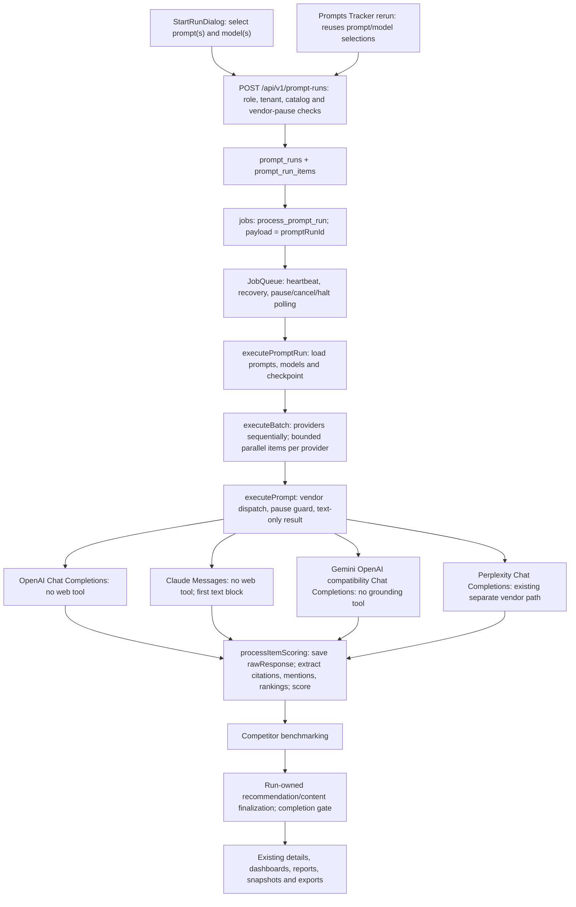
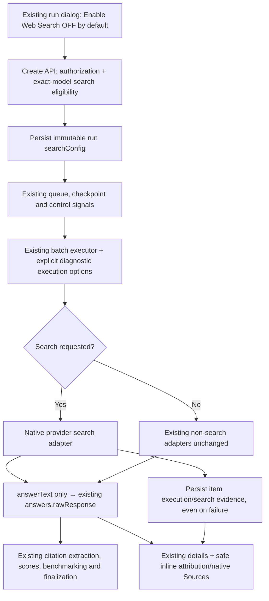

# Prompt Runs native web search — architecture and MVP readiness audit

**Date:** 2026-10-20 (Asia/Dubai; also 2026-10-20 UTC)  
**Disposition:** Audit complete. Implementation has not started.  
**Priority:** Native search for Prompt Runs first; sequence additional features afterward.  
**Scope:** Read-only repository and documentation review, read-only development model-catalog query, and public official-provider documentation research.

## Executive summary

**Native web search is not currently implemented in the Prompt Runs execution path for OpenAI, Anthropic, or Google.** There is an earlier discovery document, but no persisted run setting, native search request, normalized search evidence, or search-specific response presentation in the current path.

The smallest maintainable implementation is an **opt-in branch at the existing diagnostic answer-generation boundary**, not a replacement retrieval system:

1. Add **Enable Web Search**, default **OFF**, to run creation.
2. Persist an immutable run configuration; carry it through the existing queue, batch executor, and provider adapters.
3. Keep the existing non-search adapters unchanged when OFF.
4. When ON, use OpenAI Responses `web_search`, Claude Messages server-side search, and—only after resolving the restrictions below—Gemini native `generateContent` with Google Search grounding.
5. Return answer text separately from provider-native sources, citations, tool events, and usage. Feed **only answer text** through today's scoring and benchmarking path.
6. Persist search evidence against the run item, including failures that have no answer. Show it in existing response details, without treating search-source metadata as existing scored citations.
7. Validate exact model IDs, tool invocation, historical reads, retries, pause/resume, reporting, and exports before an opt-in rollout.

### Findings that affect the rollout decision

| Priority | Finding | Consequence |
|---|---|---|
| Blocker for Google | Current Gemini Developer API grounding terms prohibit, among other uses, analyzing grounded results and restrict storage, redistribution, and display. | Polaris scores, benchmarks, stores, and reports on responses. Obtain confirmation of applicable contractual permission before enabling Google grounding for this use case. Internal approval alone does not override provider terms. |
| Blocker for exact Google model identity | Google's model page says `gemini-3.7-flash`, currently the Core Google model in the development catalog, automatically routes to `gemini-3.8-flash`. | Submitting the selected ID does not prove the selected model actually ran. Do not silently substitute or describe this as unchanged model identity. |
| High | Existing text-only adapters discard tool/citation/usage metadata; Claude reads only the first text block. | Merely adding a `tools` field would lose attribution, miss embedded tool failures, and potentially truncate the answer. |
| High | Existing retry layers can multiply paid work, and control checks do not abort an in-flight provider request. | Search needs an explicit request deadline, cancellation propagation, bounded continuation, and one retry owner within the new branch. |
| High | Existing visibility scoring already includes a self-citation bonus. | Appending a native source list to `rawResponse`, or inserting native sources into the existing scored citation table, would change scores without changing a formula. |
| High | Current capability evidence is not equivalent to live search validation. | The development catalog has 25 model rows, 20 enabled. An earlier 13-model non-search validation cohort is not a search allowlist. |
| Medium | Rerun, duplicate-selection checks, summaries, and exports currently have no run-search configuration. | An implementation limited to the start dialog would be incomplete and could silently lose search mode on rerun. |

**Recommendation:** Approve the shared, default-OFF native-search MVP described here. Resolve the Google contractual and model-identity questions before its enablement. If speed requires an OpenAI/Claude-first release, explicitly approve that narrower first release; it is not completion of the requested three-provider feature.

**Estimated implementation effort:** approximately **6–10 engineer-days**, including automated regression coverage and controlled live validation, excluding provider/legal response time. These are planning estimates, not measured delivery promises. No provider generation calls were made by this audit.

---

## 1. Brief, method, and confidence

### 1.1 Inputs and authorization boundary

The two supplied briefs were read in full:

- `attached_assets/Pasted--Task-Polaris-Web-Search-Integration-Read-Only-Technica_1792484015014.txt`: read-only senior-architecture review; deliverables A–J; implementation requires subsequent review/approval.
- `attached_assets/Pasted--Polaris-Native-Web-Search-MVP-Implementation-Objective_1792483932631.txt`: the **target acceptance requirements**, not authorization to implement within this audit.

This report consolidates both into one dated audit, as requested. It does **not** implement search, alter a schema, enable a model, change a secret, call a paid generation API, or publish anything.

### 1.2 Review coverage

- Inventoried and supplied the complete text of **63 tracked project documentation files** for machine-assisted review, in four untruncated groups: PRD, `docs/`, root context, and changelog/internal README material. The corpus is approximately 1.1 million characters.
- Read the two supplied audit/MVP prompts separately.
- Directly inspected the relevant implementation path and targeted source sections to check the architectural conclusions. Used source over stale prose where they disagree.
- Queried **only model metadata** from the **development** database: vendor, model ID, enabled/category/internal-only flags. No client responses or account credentials were needed.
- Fetched current public official documentation for the three providers, including exact model pages where available and Google's grounding terms. These sources were retrieved on 2026-10-20.

Appendix A identifies all 63 project documents. Full-text assisted review is not a claim that every line of every historical document was independently manually verified. Application claims below use targeted code evidence.

**Excluded:** dependency documentation, generated/runtime output, raw crawl dumps, platform skill files, unrelated attachments, and secret values. Earlier login/account questions are unrelated to this report; no account credentials or hashes appear here.

### 1.3 Evidence labels

- **Verified repository:** current source or development metadata observed during this audit.
- **Provider-documented:** current official public documentation; not proof of account entitlement or a successful call.
- **Proposed:** the recommended implementation, not current behavior.
- **Unverified:** requires an exact-model/provider-account test, runtime test, or contractual confirmation.

**Production limit:** this audit is of the current workspace and development catalog. It does not establish that the published deployment has the same revision, schema, model flags, or provider permissions. No production mutation or production search smoke test was performed.

---

## A. Current architecture and execution map

### A.1 End-to-end flow



### A.2 Exact control and data boundaries

| Boundary | Current evidence | Audit conclusion |
|---|---|---|
| Start UI | `client/src/components/start-run-dialog.tsx:181-190` posts client ID, prompt IDs, model IDs, name and legacy `createdBy`. | No search toggle/configuration is submitted. Server derives the actual actor. |
| Rerun UI | `client/src/pages/prompts-tracker.tsx:311-326`; `server/routes/prompt-runs.ts:306-314`. | Rerun selections contain only prompt/model IDs; search settings would currently be lost. |
| Create API | `server/routes/prompt-runs.ts:131-205`. | Validates role, known/enabled/internal model access, vendor pause and tenant prompts. Zod create schema has no search option; adding an unknown field to today's request does not enable search. |
| Persistence/enqueue | `server/routes/prompt-runs.ts:215-244`; `shared/schema.ts:349-403`. | Creates a run and prompt×model items; queues only `{promptRunId}`. Configuration must be persisted on the run, not held only in memory or the dialog. |
| Job orchestration | `server/services/job-queue.ts:36-40,1025-1105`. | Four concurrent jobs; 30-second heartbeat; 15-minute stale threshold; up to three recovery attempts. Control state polled every two seconds. |
| Run orchestration | `server/services/prompt-run-executor.ts:282-315,369-412,455-497`. | Loads current prompt/model rows and uses completed-item checkpoints. Search configuration should be read once from the run and remain stable across recovery. |
| Batch | `server/services/batch-executor.ts:10-23,45-99,125-175,217-243`. | Per-provider concurrency OpenAI 5, Anthropic 3, Perplexity 3, Google 1; providers execute sequentially. Cancellation checks occur between chunks/results, not inside an active request. |
| Provider dispatch | `server/services/ai-executor.ts:1-98,103-347`. | Result is centered on text/error/duration/provider/status; no native search evidence contract. |
| Client scoring | `server/services/prompt-run-executor.ts:108-201`. | `result.rawResponse` is saved and reused by citation extraction, mention detection, ranking parsing, visibility and sentiment. |
| Competitor scoring | `server/services/competitor-scoring.ts:59-117`. | Competitor processing extracts/scorers from the same saved answer text. Contamination would affect both client and competitor scores. |
| Finalization | `server/services/prompt-run-executor.ts:829-907`; `server/services/prompt-run-deliverables.ts`. | Recommendations/content finalize inside the visible run lifecycle. Delivery warnings are separate from core response status. Preserve this ownership. |
| Existing result API/UI | `server/routes/prompt-runs.ts:320-379`; `client/src/components/run-details-section.tsx:1246-1259,1601-1622`. | Answers are displayed as escaped plain text; extracted citations have links. This is not native inline attribution support. |

### A.3 “Single prompt” versus batch

There is no separate native-search-ready single-prompt execution endpoint in the inspected routes. `executePrompt` is called from the batch executor; the creation API accepts prompt/model arrays. A run with one selected prompt is the current single-prompt case; multiple model selections still create multiple items.

**Proposed acceptance interpretation:** the same toggle works for one selected prompt and for multi-prompt diagnostic runs. Verify the actual UI entry points during implementation; do not invent a parallel synchronous endpoint unless a separate single-prompt experience is explicitly requested.

### A.4 Existing provider implementations

- **OpenAI:** `chat.completions.create`, wrapped by `withVendorRetry`; reads `choices[0].message.content`. Existing model-family branches omit temperature for certain reasoning models and allocate larger completion budgets. See `server/services/ai-executor.ts:103-191`.
- **Anthropic:** `messages.create`, no `tools`; uses `.find()` for the first text content block. See `server/services/ai-executor.ts:194-249`. Native search can interleave text and server-tool blocks, so that extraction cannot be reused unchanged for search.
- **Google:** instantiated through the OpenAI SDK at `https://generativelanguage.googleapis.com/v1beta/openai/`; reads Chat Completions text only. See `server/services/ai-executor.ts:255-308`.
- **Perplexity:** existing OpenAI-compatible path at `https://api.perplexity.ai`; text-only result. See `server/services/ai-executor.ts:314-347`. This is not evidence that the other three vendors search. Perplexity's service can itself search even when the proposed Polaris toggle is OFF.

### A.5 What is not part of this toggle

Internal model functions have a separate configurable layer: `server/config/llm-functions.ts:19-53,298-306`. The AEO configuration resolves scoring models through that layer (`server/config/aeo.ts:92-100`).

Do **not** spread the flag globally into `server/llm/*`, scoring, extraction, prompt generation, recommendations, content drafts, summaries, or report narratives. They may consume the generated answer just as they do today, but must not gain web tools themselves.

---

## B. Provider capability and model readiness

### B.1 Native API matrix

| Dimension | OpenAI | Anthropic | Google |
|---|---|---|---|
| Current Polaris API | Chat Completions, no search tool | Messages, no search tool | OpenAI-compatible Chat Completions, no grounding |
| Proposed search API | Responses `/v1/responses` | Existing Messages API with server-side search | Native Gemini `generateContent` |
| Native tool | `{type:"web_search"}` | `{type:"web_search_20250305",name:"web_search",max_uses:5}` for the basic MVP | REST `{google_search:{}}` / SDK `googleSearch:{}` |
| Why not just reuse today's parser? | Responses has output items, tool events, message text and annotations, not `choices[0]` | Multiple text/tool blocks; tool-result errors can arrive in HTTP 200 | Native candidates/parts and grounding metadata are not the current compatibility response |
| Invocation evidence | `web_search_call` output with action/status; distinguish successful search from a failed event | `server_tool_use` plus `web_search_tool_result`; usage search count when present | Non-empty `groundingMetadata.webSearchQueries`; related supports/chunks as supporting evidence |
| Citations/sources | Text `url_citation` annotations; request `include:["web_search_call.action.sources"]` for consulted sources | `web_search_result_location` citations and tool result sources | `groundingChunks`, `groundingSupports` and response segments |
| Text extraction | All final assistant output-text segments, excluding reasoning/tool payloads | All final text blocks in order, excluding thinking/tool payloads | Final candidate text parts, excluding thought parts/tool payloads |
| Attribution/UI | Visibly clickable inline citations; distinguish consulted from cited sources | Preserve citation-to-text association and source links | Display required Search Suggestions with grounded result, plus supported attribution; terms review is a release gate |
| Stop/error cases | Failed/incomplete response, incomplete tool calls, refusal, empty answer | Embedded tool errors, `pause_turn`, refusal, max-token truncation | Blocked prompt/candidate, missing candidate, finish reason, metadata absent, API error |
| Model choice | Keep selected model ID; verify exact Responses/search support | Keep selected model ID; verify basic tool version, account permission and token settings | Keep selected ID only if actual routing/model identity is acceptable and disclosed; no silent replacement |
| Non-search path | Leave existing Chat Completions behavior intact | Leave current Messages behavior intact | Leave current compatibility behavior intact |
| Commercial caveat | Tool fees and search-content tokens in addition to normal tokens | Tool requests plus model/context tokens; organization search setting may block | Pricing differs by model generation; contractual restrictions may prevent Polaris's analytical use |
| Live status in this audit | Not tested | Not tested | Not tested; enablement blocked pending permission/routing decision |

Sources: O1–O3, A1–A3, G1–G5 in Appendix B.

**Search enabled is not search invoked.** With model-directed tool use, a model may answer without searching. Do not infer invocation from the checkbox, presence of a URL, response wording, or a nonzero token count. A successful no-search answer should be labeled `not_invoked`, not a grounded/search-verified result.

**Do not force a new behavior without approval:** OpenAI can be forced to use a tool through tool choice, but model-directed availability is the closest fit for “Enable Web Search.” Claude and Gemini do not provide an identical cross-provider guarantee. The MVP should expose honest evidence, not promise that every enabled response performed a search.

### B.2 Development catalog observed on 2026-10-20

Query used:

```sql
SELECT vendor, model, enabled, category, internal_only
FROM ai_models
ORDER BY vendor, model;
```

Result: **25 rows; 20 enabled; 5 disabled; no internal-only rows in this development snapshot.** This is a metadata snapshot, not a production inventory. The current seed source and its 13-model validated cutover do not enumerate every retained development row (`server/seed.ts:47-93,126-142`).

| Vendor / exact catalog ID | Dev enabled | Public evidence reviewed | Search rollout treatment |
|---|---:|---|---|
| OpenAI `gpt-5.6-terra` **Core** | Yes | Exact model card explicitly lists Web search Supported (O2) | Candidate; live selected/actual model and tool test required |
| OpenAI `gpt-5.6-luna` | Yes | Exact model card explicitly lists Web search Supported (O2) | Candidate; live validation required |
| OpenAI `gpt-5.4` | Yes | Model card and search guide support (O1/O2) | Candidate; respect reasoning-setting caveats |
| OpenAI `gpt-5.4-mini` | No | Exact model card lists search support (O2) | Keep disabled; provider support does not authorize enablement |
| OpenAI `gpt-5.4-nano` | Yes | Exact model card lists search support (O2) | Candidate; do not infer from “nano” that it is unsupported |
| OpenAI `gpt-5.2` | Yes | Exact model page fetched; search support not established from retrieved text | Unverified; capability check/smoke before allowlisting |
| OpenAI `gpt-5.1` | Yes | Exact model page fetched; search support not established from retrieved text | Unverified; do not substitute a newer model |
| OpenAI `gpt-5-mini` | Yes | Exact model page fetched; search support not established from retrieved text | Unverified; preserve reasoning-model request constraints |
| OpenAI `gpt-4.1` | Yes | Search guide explicitly discusses its Responses search context limit (O1) | Candidate; live validation required |
| OpenAI `gpt-4o-mini` | Yes | Search pricing discusses non-preview tool content billing for this ID (O3); entitlement still untested | Candidate subject to endpoint/capability smoke |
| Anthropic `claude-sonnet-5` **Core** | Yes | Basic tool is documented; current overview does not establish exact legacy-ID/tool-version compatibility | Unverified exact combination; Models API/account check then smoke |
| Anthropic `claude-opus-5` | Yes | Same limitation | Unverified exact combination |
| Anthropic `claude-sonnet-4-5` | Yes | Basic tool is documented; exact accepted version/ID must be checked for this account | Unverified exact combination, not a claim of no provider support |
| Anthropic `claude-opus-4-1` | No | Historical row, not enabled | Keep disabled; no new-model work in MVP |
| Anthropic `claude-3-5-haiku-20241022` | No | Deprecated catalog row | Keep disabled; reject ON as unavailable |
| Google `gemini-3.7-flash` **Core** | Yes | Model card says search supported **and automatic routing to 3.8 Flash** (G2) | Block exact-identity enablement pending explicit decision; also contractual gate |
| Google `gemini-3.5-flash-lite` | Yes | Exact card and supported-model table list grounding (G1/G2) | Technically a candidate; contractual gate still applies |
| Google `gemini-2.5-pro` | Yes | Supported-model table lists grounding (G1) | Candidate after contractual and live validation gates |
| Google `gemini-2.5-flash` | Yes | Supported-model table lists grounding (G1) | Same |
| Google `gemini-2.5-flash-lite` | Yes | Supported-model table lists grounding (G1) | Same |
| Google `gemini-3-pro-preview` | No | Retained legacy/preview row | Keep disabled; do not revive or swap |
| Google `gemini-1.5-pro` | No | Deprecated row | Keep disabled |
| Perplexity `sonar` | Yes | Existing fourth-provider path; not audited as one of the three target adapters | Do not claim normalized native-search support from this MVP |
| Perplexity `sonar-pro` | Yes | Same | Same |
| Perplexity `sonar-reasoning` | Yes | Same | Same |

“Unverified” is intentionally different from “unsupported.” Omission from a current model overview is not proof that an older ID cannot use search.

Anthropic's current Models API documentation describes `capabilities.server_tools.web_search.supported`, but notes that support means **at least one tool version**, and organization policy can still reject it (A2). Check the selected basic version as well. The installed SDK need not support that newer capability field to make a read-only HTTP capability check during implementation.

### B.3 SDK and endpoint fit

- Installed **OpenAI 5.23.2** has Responses types for `web_search`, URL citations and `web_search_call.action.sources`.
- Installed **Anthropic SDK 0.65.0** has the basic `web_search_20250305` tool, tool-result errors, search usage and `pause_turn` types.
- No native Google SDK is required to use the documented REST `generateContent` API. Prefer a small typed native REST adapter for the search-only branch, or introduce the official SDK only if its benefit justifies a dependency change.
- Therefore, a blanket major SDK upgrade is **not** a prerequisite established by this audit. Compile the exact intended request/response shapes first; upgrade narrowly if needed.
- Do not use obsolete Chat Completions search-preview model substitutions. Current OpenAI documentation distinguishes Responses hosted search from specialized Chat Completions search models (O1).

### B.4 Cost and limit implications

Provider pricing retrieved on the audit date:

- **OpenAI:** published `web_search` fee is **$10 per 1,000 calls**, plus search-content tokens at the applicable model input price, plus normal generation usage. There are special token-billing rules for some smaller models (O3).
- **Claude:** **$10 per 1,000 searches** plus model/token costs; `max_uses:5` limits search uses in the request. Tool-result errors require their own handling even when transport succeeds (A1).
- **Gemini 3 and newer:** the grounding guide describes billing per executed search query, including the possibility of multiple queries in one generation. Current pricing lists a shared free allowance and then **$14 per 1,000 requests/queries**, subject to the applicable model row (G1/G3). Do not translate one Prompt Run item into one billed search.
- **Gemini 2.5 and earlier:** the guide distinguishes grounded-prompt billing from the newer per-query model. Confirm the exact current model/account pricing row before displaying an estimate; this audit does not assert a verified 2.5 dollar rate.

For illustration only, 100 responses averaging two billed searches imply $2 of OpenAI/Claude search-tool fees before tokens; the analogous $14/1,000 query rate implies $2.80 before tokens and allowances. This is **not** a total-run quote: scoring, benchmarking and final deliverables also consume model calls.

Existing `ai_models.costPer1kInput/Output` fields (`shared/schema.ts:270-271`) cannot represent search fees, tool counts or tier-specific allowances. Do not label a token-only calculation “actual total cost.” Persist available usage first; any dollar estimate needs explicit units, a pricing date, and an `estimated` label.

---

## C. Recommended target architecture

### C.1 Minimal change boundary



### C.2 Configuration and eligibility

**Proposed API extension:** `webSearchEnabled?: boolean`, with strict boolean validation and omission interpreted as false for existing clients.

**Persisted canonical configuration:** a versioned run JSON value, for example:

```json
{
  "version": 1,
  "webSearch": {
    "enabled": true,
    "invocationPolicy": "auto",
    "policyVersion": "native-search-v1",
    "claudeMaxUses": 5
  }
}
```

This is an example contract, not a schema already present. Keep the public UI/API simple; the version, basic tool version and Claude cap can be server-controlled. Do not expose advanced search settings in the MVP.

- Validate exact model/vendor capability and rollout eligibility **before enqueue**, in addition to today's role, tenant, model-enabled, internal-model and vendor-pause checks.
- For ON requests containing any ineligible model, return an explicit structured 400 with the affected model IDs and reason. **Reject the request rather than silently skipping items, swapping models, or making non-search calls.**
- Distinguish `unsupported`, `unverified`, `provider_permission_required`, `provider_terms_blocked`, and `search_temporarily_disabled` in actionable messages. The final API codes can be consolidated, but the reason must not be hidden.
- Recheck emergency disable/vendor pause at execution time. A queued search request must fail explicitly if disabled; it must not fall back to OFF.
- A same-settings rerun inherits the source's search configuration. Starting a new unrelated run defaults OFF. The selections endpoint and frontend cache types must include the run configuration.
- Duplicate-selection comparisons should include the effective search mode so an ON run is not conflated with an OFF baseline.
- For Perplexity in a new ON request, explicitly reject as outside this normalized feature until separately supported. OFF retains its current behavior. UI wording should not claim that OFF disables all provider-side web behavior.

### C.3 Normalized execution result

Keep `rawResponse` compatible as the field consumed by current scoring, but define it as **final assistant answer text**, not serialized provider output. Add a typed optional evidence structure, conceptually:

```ts
type SearchStatus =
  | "disabled"
  | "invoked"
  | "not_invoked"
  | "failed"
  | "unknown";

interface NativeSearchEvidence {
  version: 1;
  requested: boolean;
  provider: string;
  requestedModel: string;
  actualModel: string | null;
  actualModelEvidence: "provider_reported" | "not_reported";
  invocationStatus: SearchStatus;
  providerRequestId?: string;
  toolType?: string;
  searchCount?: number;
  sources: Array<{
    id: string;
    url: string;
    title?: string;
    kind: "cited" | "consulted";
  }>;
  citations: Array<{
    sourceIds: string[];
    textStart?: number;
    textEnd?: number;
    providerLocator?: unknown;
  }>;
  usage?: Record<string, number | string | null>;
  generationDurationMs: number;
  attemptCount: number;
  error?: { code: string; message: string; retryable: boolean };
}
```

This is a design sketch, not a license for unbounded arbitrary JSON. Specify runtime schemas, allowed usage keys, source limits, string limits and locator structure in implementation.

Additional rules:

- Track tool **attempted**, tool **completed successfully**, and **unknown** separately if needed; a failed tool-call output must not become `invoked` success merely because an event exists.
- `actualModel:null` means the provider did not report it. Never copy `requestedModel` into that field as fabricated evidence.
- Deduplicate display URLs without destroying provider citation indices or merging cited and merely consulted sources.
- Keep provider index units identifiable. Convert annotations against the exact saved answer string; test Unicode, multi-block joins and non-ASCII text.
- Save only metadata needed for evidence and attribution, not full raw web pages, hidden reasoning, encrypted search payloads, or unrestricted provider JSON.
- Preserve the provider's original block/segment association when a simple character span is not reliable. A wrong inline citation is worse than an explicit unmapped source list.
- Gemini's required attribution payload is a separate provider-specific concern, subject to the contractual gate. Do not coerce it into scored answer text.

### C.4 Provider branch details

**OpenAI**

- Search branch alone uses `responses.create` with the selected ID, the existing system instruction and prompt text, `tools:[{type:"web_search"}]`, and source inclusion.
- Preserve semantic prompts and applicable token/reasoning constraints; do not mechanically transfer Chat Completions-only parameter names.
- Read all final assistant output text and URL annotations. Record the response model/request ID and tool statuses.
- Validate response completion, refusal and truncation. Partial or empty text with a failed tool is not a fully successful searched answer.

**Claude**

- Keep Messages; add the basic server tool with `max_uses:5`. No dynamic filtering, code execution, web-fetch tool or client-side search loop in this MVP.
- Concatenate final text blocks in order, retaining their citation mapping. Do not reuse today's first-text-only `.find()` extraction for this branch.
- Inspect tool results for errors such as max-use exhaustion or unavailable search even on HTTP 200.
- Handle `stop_reason:"pause_turn"` by continuing the unchanged assistant response under a bounded total deadline/continuation count and checking app cancellation. This provider stop reason is **not** the application's paused-run state.
- Keep tool limits bounded across the **whole item**, not merely each continuation request. Do not reset the practical search budget indefinitely.

**Google**

- Only after applicable permission is confirmed, use native `generateContent`, with the same diagnostic instructions/content and `google_search`.
- Read candidate final text, reported `modelVersion` when supplied, usage, finish/safety status and grounding metadata.
- Treat nonempty search queries as stronger invocation evidence than sources alone. Empty/missing grounding is not automatically an API failure, nor proof that search ran.
- Preserve Search Suggestions and attribution as required by the applicable terms. Do not inject raw HTML into the application or use a framing/caching workaround around contractual restrictions.
- `gemini-3.7-flash` routing needs an explicit decision before enablement. A 2.5 or 3.5 model is not an automatic replacement for the user's selected Core model.

### C.5 Reliability and state

The existing wrappers use `withVendorRetry` defaults of three attempts and a 10-second elapsed retry check (`server/llm/retry.ts:32-36,91-114`). That check is **not** an in-flight request deadline. Installed SDKs default to two automatic retries and approximately ten-minute request timeouts unless overridden. The outer batch permits an initial attempt plus five retries (`server/services/batch-executor.ts:18,57-89`).

**Proposed for the new search branch only:**

1. One end-to-end item deadline, bounded search/continuation budget, and an `AbortSignal` passed into provider requests.
2. One retry owner; explicitly disable overlapping SDK/batch retry ownership for this branch. Retry only appropriate 408/429/5xx/network failures, with bounded jitter and provider `Retry-After` where available.
3. No retries for unsupported models, invalid tools, blocked terms/permissions, safety refusal or configuration errors. Surface embedded tool failures.
4. Check the three existing app control signals during waits, retries and continuations. Do not wrap them into ordinary provider failures or retry them.
5. Persist execution evidence before scoring, and resume from an already saved generation rather than paying for a fresh generation after a scoring-only crash.
6. No architecture claim of exactly-once provider execution: a crash between provider completion and durable persistence can still lead to a repeat charge. Keep that residual risk visible.

Provisional deadlines must be measured against current-fact and comparison fixtures; do not simply increase the eight-hour job cap and call request safety solved. `server/services/job-timeout.ts:22-29,38-75` currently estimates work using fixed non-search item and competitor costs.

---

## D. File-level impact matrix

Effort is relative: **S** ≈ a few hours, **M** ≈ half to one day, **L** ≈ one to two days. Rows overlap and are not additive estimates.

| Existing file / function / table | Current behavior | Proposed change | Dependency; breaking risk | Effort | Required test | Rollback / migration treatment |
|---|---|---|---|---|---|---|
| `client/src/components/start-run-dialog.tsx` / start mutation | Creates prompt/model run, no search setting | Default-OFF toggle, concise cost/availability notice, explicit disabled-model feedback | Capability contract; low–medium UI risk | S–M | One prompt/many prompts; toggle reset; payload false/true; viewer access | Hide/disable toggle; omission stays OFF |
| `client/src/pages/prompts-tracker.tsx` / rerun | Fetches and reuses prompt/model IDs | Inherit search settings; include mode in duplicate-set logic/cache typing | Selections API; medium silent-behavior risk | M | ON rerun stays ON; legacy rerun OFF; mixed-mode duplicate check | Keep readable persisted setting; reject ON if feature disabled |
| `server/routes/prompt-runs.ts` / POST, selections, results | Validates catalog/tenant and returns text-scoring data | Strict optional boolean; exact-model eligibility; save config; additive bounded detail evidence | Schema, policy; high security/cost boundary | M | CSRF/RBAC/tenant; spoofed IDs; unsupported model; no enqueue on rejection | Old callers omit field; disabled search fails explicitly |
| `server/routes/openapi.ts` | Documents create/result schemas without search | Add request/config/evidence and explicit errors | API shape; low | S | Contract matches runtime; strict boolean; legacy examples | Additive fields only |
| `shared/schema.ts` / `prompt_runs` | No search mode/config | Add non-null versioned `search_config` with OFF default | Migration; medium | S–M | Old rows/callers OFF; invalid shape rejected in app | Retain column; don't drop on disable |
| `shared/schema.ts` / proposed item-evidence table | Existing answers require text; errors only on items | One bounded versioned execution record per item, including failures and pre-scoring answer checkpoint | Storage/deletion/retention; high | M | Error without answer; resume; unique item evidence; cascade cleanup | New table retained; off-code ignores it safely |
| `server/storage.ts`, `server/db-storage.ts` / `IStorage`, run create/read/delete | Typed storage, summary aggregates and explicit delete flow | Add config defaults and evidence CRUD; bounded detail-only retrieval; atomic generation persistence | Schema, in-memory parity; high | M–L | DB/MemStorage parity; legacy rows; delete; summary avoids large JSON | Preserve old return fields; no destructive rollback |
| `server/services/prompt-run-executor.ts` / execute, callback, scoring | Builds batch items; answer/scoring/checkpoint/finalization lifecycle | Load immutable config; carry options; save evidence before scoring; recover saved generation; keep scoring text-only | Storage/batch; high lifecycle risk | L | Crash after generation; scoring retry; pause/cancel/halt; partial errors; deliverables unchanged | OFF uses old path; retain evidence for recovery |
| `server/services/batch-executor.ts` / `BatchItem`, retry, provider batch | Text/vendor/model item; layered retries and chunk control checks | Explicit diagnostic options and abort/deadline; coordinate search retry ownership | Adapter policy; high paid-work risk | M–L | Retry caps; 429/5xx vs 400; abort during sleep/request; exact signals | Branch behavior by persisted config |
| `server/services/ai-executor.ts` / `executePrompt` | Vendor dispatch and text-only results | Optional typed execution options; preserve OFF call path; return normalized evidence | New native adapters; high | M | OFF request snapshots byte-for-byte semantics; no hidden fallback | Remove eligibility, not stored metadata |
| Proposed `server/services/native-web-search/` adapters and normalizer | Not present | Focused OpenAI, Claude, Gemini modules; normalization and capability policy | Provider docs, terms, runtime types; high | L | Provider payload fixtures, embedded errors, text ordering, citations, usage | Emergency switch gates new calls |
| `server/services/job-queue.ts`, `job-timeout.ts`, `prompt-run-reaper.ts` | Cooperative controls, recovery, non-search workload estimates | Thread request abort/control context only as needed; search-aware estimates without changing terminal semantics | Executor; medium–high | M | Long healthy run survives; bounded abort; restart/resume; reaper excludes paused | Existing signals/status vocabulary unchanged |
| `client/src/components/run-details-section.tsx`, `run-details-drawer.tsx` | Plain answer plus extracted citation links | Native search requested/invoked status; safe provider-linked annotations; separate Sources; actual-model evidence | Bounded results contract; medium | M–L | Both presentations; safe URLs; inline Unicode spans; legacy answer | Legacy render path retained |
| `server/services/citation-extractor.ts`, `visibility-scoring.ts`, `competitor-scoring.ts` | Extract and score answer text; self-citation bonus | **No formula changes.** Add boundary/regression tests, not native sources into score inputs | Normalizer; high contamination risk | M tests | Identical answer text + different metadata yields identical scores/citations | No rescore/backfill |
| `server/services/report-aggregator.ts`, `report-snapshot.ts`, `csv-exporter.ts`, `json-exporter.ts`; detail text export | Existing scores/citation data feed snapshots and exports | Preserve current contracts; add mode provenance only where additive/needed to prevent mislabeling; provider attribution/permission must cover any grounded export | Schema/terms; medium–high | M | Existing files still parse; old snapshots unchanged; ON/OFF not silently equated | Keep old fields/columns; no historical rewrite |
| `server/tests/` and provider-normalizer fixtures | Existing model access, run list, reaper, deliverables tests | Search-specific unit/route/lifecycle/export tests; guarded paid smoke runner | All implementation stages; high verification value | L | Matrix in section I | Test-only; live tests explicitly opt-in |
| `docs/`, PRD/backlog/changelog | Older discovery and validation assumptions | Record approved architecture, model support evidence, controls and actual rollout status after implementation | Owner decisions; low | S | Links/evidence current; no “enabled” claims before rollout | Keep this audit immutable as dated evidence |

Do not use the matrix as permission to refactor every listed service. Most scoring/report files need regression coverage, not a new execution architecture.

---

## E. Database and migration plan

### E.1 Current fit and missing fields

- `prompt_runs` has status/error/delivery/heartbeat fields, but no execution/search configuration (`shared/schema.ts:349-374`).
- `prompt_run_items` holds prompt/model foreign keys, status, timestamps and error, but no generation provenance (`shared/schema.ts:376-387`).
- `answers.raw_response` is non-null and carries scores plus a cached report summary (`shared/schema.ts:389-403`).
- `citations` is an existing **answer-derived analytical table** with citation type, position and self-citation flags (`shared/schema.ts:405-418`).
- Checkpoints retain completed item IDs, stage, workload and timeout (`shared/schema.ts:675-686`), not a native generation response.
- `RunLogger` persists logs, while performance metrics are primarily held in an active-run map (`server/services/run-logger.ts:44`; `server/services/performance-logger.ts:40,81-109`). Logs are not a substitute for structured, queryable per-item evidence.

### E.2 Proposed additive model

1. **Run configuration:** `prompt_runs.search_config JSONB NOT NULL` with a versioned OFF default. Old rows mean “Polaris did not request native web tools,” not “the provider definitely never searched.”
2. **Item execution evidence:** a new table, e.g. `prompt_run_item_executions`, with a unique item foreign key, normalized answer text/checkpoint, normalized bounded evidence JSON, status and timestamps.
3. Keep easily queried operational fields explicit if needed: provider, requested/actual model, search requested/status, generation duration, attempts and error code. Avoid duplicating every field both inside and outside JSON without one canonical source.
4. Record search failures here even when no `answers` row is created. An answer-only metadata field cannot satisfy that requirement.
5. Preserve the answer text checkpoint before scoring. Resume should reuse it; keep the existing completed-item checkpoint and statuses.
6. Use transactional/idempotent storage for evidence and the scored-answer association. Existing `answers` has an index, not a unique constraint on `promptRunItemId`; do not assume uniqueness has already been guaranteed (`shared/schema.ts:401-403`).
7. New item evidence can cascade on item deletion, or the current explicit deletion flow can delete it first. Check both DB and in-memory implementations.

For permitted providers, the evidence table may retain normalized answer text for resumability. **Do not apply this storage plan to Google grounded content until the applicable permission/retention policy is established.** A blanket historical backfill or indefinite raw-response archive is not approved.

### E.3 Deployment sequence — proposal, not executed

1. Inspect both development and production schema/catalog metadata at implementation time. Do not copy dev flags into production.
2. Review an **additive schema diff**: run config, new evidence table/index/FK. No changes to score columns or existing enums are required.
3. Follow this project's migration conventions: `migrations/README.md:3-15` says existing deployments use Drizzle push mode; the baseline SQL is fresh-install-only. Do not replay the baseline or blindly apply a diff that drops unrelated objects.
4. Test on a disposable approved database or isolated fixtures; verify defaults, constraints, insert/read/delete and legacy compatibility. Do not run schema-mutating tests against production.
5. Deploy schema compatibility before code can enable new search requests; keep the server feature gate OFF.
6. Publish application changes only after approval, then verify production read-only metadata and run explicitly authorized, budgeted search tests.
7. Enable by validated model/provider subset; observe failures, latency and tool counts before broader access.

### E.4 Rollback

- Immediate mitigation is a server-side emergency disable for new search calls, plus UI disable. A UI-only hidden toggle is not a kill switch.
- Queued ON requests fail explicitly or remain paused under a documented policy; never silently convert to non-search. In-flight abort is best-effort and cannot guarantee reversal of provider billing.
- Keep the additive schema/evidence so previous searched results remain readable and resumable.
- Do not blindly deploy an older binary while ON jobs are pending: it could ignore the new configuration and resume with non-search behavior. Drain/cancel those jobs or use a rollback-compatible worker first.
- Destructive column/table removal is a separate later migration after retention and compatibility review, not part of an incident rollback.

---

## F. Scoring, history, reporting and export compatibility

### F.1 Boundary invariant

> For the same final answer string and the same scoring configuration, enabling search or changing native search metadata must not change client or competitor scores.

Search can legitimately produce a **different answer**, so an ON/OFF live comparison is not an equality test for answer quality or score values. The equality test uses identical answer fixtures with different metadata.

Current source makes the risk concrete:

- Answer saved from `result.rawResponse`: `server/services/prompt-run-executor.ts:119-128`.
- Citations extracted from that exact string: lines 130–143.
- Mentions/rankings use it: lines 147–163.
- Self-citations feed visibility: lines 178–189.
- Sentiment receives it: lines 192–201.
- LLM and heuristic visibility apply the existing citation bonus: `server/services/visibility-scoring.ts:89,113-154`.
- Competitor scores independently extract citations from saved answer text: `server/services/competitor-scoring.ts:59-117`.

### F.2 Required normalization rules

1. Save final assistant prose in `answers.rawResponse`, preserving answer ordering and meaning. Do not serialize entire provider objects into it.
2. Do not append source titles, result snippets, query text, hidden reasoning, tool logs, provider metadata or an artificial “Sources” appendix to the scoring string.
3. Strip provider control/special citation markers only through a defined mapping that preserves visible answer content and citation spans. Do not delete meaningful prose, ordinary bracket references or a source name genuinely written in the answer.
4. Native **out-of-band sources** live in the new evidence structure, not the old `citations` table. Keep “native sources” and “answer-extracted citations” visibly distinct.
5. URLs/domains genuinely present in answer prose continue through today's extractor and its existing self-citation behavior. That is not a new native source-authority score.
6. No new citation-quality, source-authority, sentiment, position, visibility or ranking formulas.
7. Preserve configured AEO/visibility/position versions; do not change environment values or choose a new scoring model as part of search enablement.
8. Do not add web tools to internal extraction/scoring/analysis calls.

### F.3 History and comparability

- Legacy rows remain readable with search metadata absent and the original text/scores untouched.
- Do not infer past search invocation from URLs or from Perplexity vendor membership.
- Label future run mode and actual invocation in existing detail views. ON/OFF runs are different experimental conditions; do not describe their differences as a model-quality change without noting mode.
- A rerun inherits settings, not necessarily identical live web content. Save evidence and generation timestamps; search freshness is not reproducibility.
- Existing snapshots should remain immutable. `reportSnapshots.snapshotData` already provides a snapshot boundary (`shared/schema.ts:620-636`).
- Report aggregation reads existing answer citation counts and citation tables (`server/services/report-aggregator.ts:515-593,688-728`). Native sources must not enter these aggregates by accident.
- Preserve current CSV/JSON/text exports and score fields. Additive provenance may be appropriate, but no new source-export feature is necessary for MVP. Check attribution/retention restrictions before exporting any grounded content; “keep exports working” does not authorize a prohibited provider use.

---

## G. Security, reliability and performance risk register

| ID | Severity | Risk / evidence | Required mitigation | Release gate / residual risk |
|---|---|---|---|---|
| R1 | Blocker | Google Developer API grounding terms restrict analysis, storage, sharing and modifications (G4). Polaris does analytical scoring and reports. | Confirm applicable written permission/contract and permitted end-user/storage/export use. Otherwise leave Google search unavailable with explicit explanation. | No Gemini analytical grounding rollout without resolution. This is a compatibility flag, not legal advice. |
| R2 | Blocker for exact identity | `gemini-3.7-flash` is documented as automatically routed to 3.8 (G2). | Record requested/reported actual model; explicit catalog/routing decision. No silent replacement. | Cannot claim selected Core model identity unchanged. |
| R3 | High | Metadata contamination changes mentions/self-citation bonus and report citation aggregates. | Separate answer text from evidence and native sources from extracted citations. | Same-answer invariance tests for both client and competitor. |
| R4 | High | Nested SDK, wrapper and batch retries can multiply paid search/tool use. A ten-second retry check is not a hard timeout. | One retry owner for new branch, request abort, total item deadline and continuation/search budget. | Test worst-case retry/timeout counts; some indeterminate requests may still be billed twice. |
| R5 | High | Search-enabled request can produce no actual search; HTTP 200 can contain Claude tool error. | Explicit requested/invoked/failed/unknown evidence and embedded error parsing. | No “searched” badge based only on settings or a URL. |
| R6 | High | Search websites and provider HTML/URLs are untrusted. Source titles can contain instructions or unsafe markup. | Keep escaped rendering; allow only valid HTTP(S) external URLs; safe link attributes; no arbitrary HTML, script, page fetch or secret exposure. Provider attribution must remain compliant. | XSS/unsafe URL fixtures. No server-side fetch/redirect unwrapping means no new source-fetch SSRF surface. |
| R7 | High | Existing pause/completion edge cases could lose checkpoints. The final guard skips a paused completion write, but checkpoint deletion follows outside that guard (`server/services/prompt-run-executor.ts:838-845,870-907`). | Add a late-pause regression test and correct only the relevant lifecycle gap during implementation if confirmed. Keep exact control signals. | Source-level potential bug, not reproduced here; do not claim pause lifecycle is fully proven safe. |
| R8 | High | Completed item IDs are written before scoring in the callback (`server/services/prompt-run-executor.ts:545-561`); crash windows can skip unfinished scoring. | Persist generation checkpoint/state explicitly and distinguish generated/scored/benchmarked completion on resume. Reuse saved answer generation. | Fault injection after provider return, evidence save, scoring start, and benchmark transition. |
| R9 | High | Tenant/provenance data could leak through a new evidence endpoint or summary join. | Reuse existing run ownership checks; validate item belongs to authorized run; no standalone unscoped evidence reads. Keep member/admin write rules and CSRF. | Cross-client/member/viewer/admin API tests. |
| R10 | Medium–High | More tokens and searches increase latency, provider limits and total workload beyond existing fixed estimates. | Conservative existing concurrency initially; measure durations; bounded payloads; search-aware item estimates; preserve heartbeat/reaper protections. | No invented performance target or concurrency increase without measurement. |
| R11 | Medium | Citation spans differ across Unicode/index units and concatenated text blocks. | Map against the saved normalized string; validate indices, reject invalid spans, retain explicit fallback evidence. | Unicode, overlapping spans, multiple citations and multiple text blocks. |
| R12 | Medium | Source metadata or HTML bloats frequently polled run lists. | Keep list summaries lightweight; fetch bounded evidence only in authorized details. | List query/payload regression and maximum source-size fixtures. |
| R13 | Medium | “Immediate rollback” with an old worker silently ignores a new ON setting. | Server kill switch plus compatible worker/drain policy; additive schema retained. | Queued/resumed ON-run emergency-disable test. |
| R14 | Medium | Grounded answer text may contain prompt-injection instructions that internal models subsequently read. | Treat generated text as data in downstream prompts; do not execute sources or grant tools based on output. Check existing report/scorer prompt boundaries. | Adversarial response fixtures; native search does not eliminate indirect injection. |
| R15 | Medium | Logs and provider payloads may expose prompts, tokens or unnecessary search content. | Persist bounded normalized metadata; redact credentials; no encrypted tool contents/hidden thoughts; define retention and access. | Logs/evidence review; Google retention constraints resolved separately. |

### G.1 Important existing controls to preserve

- Role/tenant checks, catalog access, disabled/internal model checks and vendor pause at run creation.
- Exact control messages: `"Job cancelled"`, `"Job paused"`, `"Run halted by admin disable"` (`server/services/job-queue.ts:1038-1054`; `server/services/batch-executor.ts:233-243`).
- Paused state is not a successful terminal state and must not be overwritten by completion.
- `done` is the successful run status, not an invented `completed`.
- Core response errors and delivery warnings remain separate.
- A late model-disable halt must not become a cancellation or a new success.

Do not expand this audit into the backlog's broad atomic-disable refactor, worker redesign, or side-by-side comparison feature. Fix only a demonstrated lifecycle issue necessary for this feature; track independent issues separately.

---

## H. Phased implementation backlog and estimates

These are sequenced work packages within the priority feature, not authorization to implement or a replacement for owner review.

| Phase | Deliverable | Depends on | Estimate | Exit criterion |
|---|---|---|---:|---|
| 0 — Resolve gates | Confirm exact model support/account permission; Google terms and automatic routing; agree invocation/failure policy and initial rollout subset | Owner/provider input | 0.5–1 day engineering; external wait unknown | Written decision log; no silent model swap; Google scope explicit |
| 1 — Shared contract and persistence | Default-OFF run config; item evidence/generation checkpoint; additive schema/storage/API/OpenAPI; capability validation | Phase 0 contract | 1–1.5 days | Legacy clients/rows OFF; tenant-safe failures; durable resume contract |
| 2 — Native adapters | OpenAI Responses and Claude basic server search; common normalizer, bounded retry/deadline/control behavior; Google native adapter only under permitted scope | Phase 1 | 1.5–2.5 days | Fixture evidence correct; OFF paths unchanged; model preserved; errors explicit |
| 3 — Existing UI and lifecycle | Toggle, rerun/config inheritance, duplicate distinction, detail attribution/sources/status, late-pause/crash handling | Phases 1–2 | 1–1.5 days | One/many prompt flow complete; safe source rendering; resume avoids completed generation calls |
| 4 — Regression and controlled live proof | Unit/API/lifecycle/export regressions; type/build; exact-model paid smoke matrix and on/off diagnostic | Phases 1–3 and provider gates | 1.5–2.5 days | Acceptance matrix signed off; evidence saved without secrets |
| 5 — Opt-in rollout | Approved publish, schema verification, feature gate activation for validated subset, monitoring and disable drill | Phase 4 | 0.5 day | Production state verified separately; explicit rollback ready |

**Planning total:** roughly **6–10 engineer-days** after normal rounding and integration overlap. Provider permissions, contractual clarification or catalog changes can add elapsed time and may block full three-provider completion.

### H.1 Explicitly deferred

- Tavily, SerpAPI, third-party retrieval or a new crawling/indexing system.
- Domain filters, search-location controls, adjustable search-depth UI or other advanced settings.
- Dynamic Claude filtering/code execution, agentic multi-tool workflows or deep research.
- Source-authority scoring, native-citation quality metrics or a new visibility formula.
- UI redesign, new reports, new comparison dashboard or side-by-side iteration comparison.
- General model-catalog migration, broad SDK upgrades, unrelated auth/password changes.
- Changing report/scoring/prompt-generation model assignments.
- Historical rescoring/backfill or rewriting existing exports/snapshots.

### H.2 Documentation/backlog reconciliation

| Existing material | Relevant finding | Treatment |
|---|---|---|
| `docs/chat-ui-parity-discovery.md:19-47` | Earlier discovery correctly identifies Responses search, but says no separate OpenAI search fee. | Superseded for pricing by current O3; do not base budget on that sentence. |
| `docs/chat-ui-parity-discovery.md:119-160` | Recognizes need for native Google metadata; says a native SDK is mandatory. | Native API is needed for this design; REST is a valid option. Do not add an SDK merely because old prose says so. |
| `docs/model-validation/AI-MODEL-LEAD-ARCHITECT-BRIEF-2026-08-21.md`; `TASK-25-VALIDATION-REPORT.md` | Valuable model-family and route hardening evidence, but not native-search proof for the current 25-row catalog. | Reuse safeguards; establish a separate dated search-compatibility matrix. |
| `prd/12-llm-models-prompts-and-orchestration.md`; `prd/14-scoring-and-assessment-logic.md`; `prd/17-reporting-and-exports.md` | Explain the generation→scoring→reporting boundaries and expected product contracts. | Preserve these boundaries; current source wins over older model/version lists. |
| `docs/prompt-run-scaling-plan.md`; current heartbeat/checkpoint code | Existing scaling context already addresses long jobs and recovery. | Extend minimally; no replacement queue. Native HTTP request safety is a different problem from job liveness. |
| `BACKLOG.md:8-19` | Vendor-background pause and atomic disable follow-ups. | Do not claim a broad atomic-disable redesign is complete or required by this small feature. Search must still honor current controls. |
| `BACKLOG.md:57-80` | Atomic iteration numbering, real parent lineage, side-by-side comparison. | Independent deferred work, not MVP dependencies. Inherit search settings without implementing lineage redesign. |
| `BACKLOG.md:90-96` | Older “catch stuck runs without restart” proposal. | Source now has run heartbeat and reaper behavior; do not implement a second stale-run system from stale backlog prose. |
| Changelogs, audit history, migration runbook and archive plans | Historical implementation and migration context. | Useful constraints, not proof that a proposed feature is live. Do not replay legacy schema or import plans. |

---

## I. Acceptance, regression and live validation plan

### I.1 Automated test matrix

| Area | Required cases / evidence |
|---|---|
| Defaults and compatibility | Omitted flag, explicit false, legacy row, legacy caller; OFF sends no newly added tools and preserves existing selected model/prompt behavior. Strictly reject strings/numbers masquerading as booleans. |
| Single/batch UI | One prompt/one model; one prompt/multiple models; multiple prompts/multiple models; toggle default/reset, submitted setting, no hidden advanced options. |
| Validation and security | Unknown/disabled/internal/unverified model; vendor pause; terms-blocked provider; mixed eligible/ineligible selection; tenant-spoofed prompt; viewer/member/admin; CSRF; rejection creates no paid job. |
| Model identity | Submitted ID preserved; actual model recorded only from provider evidence; missing evidence null; Google routing mismatch explicit; no fallback after unsupported-tool/model error. |
| OpenAI fixtures | Completed search call and URL annotation; consulted vs cited sources; multiple output text blocks; no tool use; refusal; incomplete/failed response; empty answer; usage absent; invalid source URL. |
| Claude fixtures | Text–tool–text blocks; thinking before text; citations on later block; successful search usage; HTTP-200 tool error; max-use exhaustion; `pause_turn` continuation; bounded total calls; refusal/truncation. |
| Gemini fixtures | Candidate text/grounding queries/chunks/supports; multiple sources per segment; no search use; thought parts; blocked prompt; missing candidate; finish-reason error; Search Suggestions present/absent; modelVersion routing. Live enablement remains terms-gated. |
| Score invariance | Same answer with zero/many native metadata sources gives identical answer-extracted citations, mentions, rankings, client and competitor visibility/sentiment/position. Test a source title containing the brand, client-domain metadata, and a high-ranking brand in a tool result. |
| Legitimate answer citations | URL/domain genuinely written in final prose still receives today's extraction/self-citation treatment. Native source metadata alone does not. |
| Controls and reliability | Cancel/pause/admin-disable during active request, retry backoff, continuation, scoring and finalization; exact errors preserved; late pause at completion; terminal states not overwritten. |
| Recovery | Restart after native response but before scoring; after evidence save; during scoring; before benchmarking. Reuse durable generation. Do not classify “generated” as “all work complete.” |
| Partial failure | One provider/model failure among successes; error evidence saved without an answer; no non-web retry; `completed_with_errors` reflects core errors; delivery warnings remain separate. |
| Rendering | Both current detail components; legacy answer; inline citations actually clickable; HTTPS/HTTP only; safe external targets; malicious HTML/title/URL; Unicode and invalid offsets; long source list bounded. |
| Reporting/exports/history | Old run details, dashboards, snapshots, CSV/JSON/text export still work. Native sources do not inflate existing citation aggregates. Mode provenance is not lost. Grounded export permitted only within resolved provider terms. |
| Performance | Run summaries avoid large evidence JSON; source count/string limits; current concurrency unchanged initially; item deadline aborts; healthy search jobs retain heartbeat and are not reaped as stale. |
| Disable/rollback | Server switch rejects new ON requests; handles queued ON requests explicitly; OFF still works; old searched results remain readable; old worker cannot silently resume ON as OFF. |

Extend the existing test conventions rather than introduce a new test framework. Useful starting suites include:

- `server/tests/prompt-run-model-validation.test.ts`
- `server/tests/internal-model-access.test.ts`
- `server/tests/ai-model-disable.test.ts`
- `server/tests/prompt-run-list.test.ts`
- `server/tests/prompt-run-reaper.test.ts`
- `server/tests/prompt-run-deliverables.test.ts`
- `server/tests/project-access.test.ts`
- `server/tests/client-model-selection.test.ts`

Implementation verification commands should include `npm run check`, `npm run build`, and targeted `npx tsx --test ...` suites after confirming their DB/test isolation. Some suites explicitly mock storage and configure a test DB placeholder; do not run an unreviewed broad suite against live data.

### I.2 Controlled live provider tests — future work, not audit evidence

After feature approval, implementation and applicable provider permissions:

1. Prepare three stable diagnostic question types:
   - **Current facts:** a question whose answer requires current, checkable information; record the date.
   - **Branded:** client/brand-specific discovery with realistic wording.
   - **Comparative:** a natural comparison/ranking question involving the brand and alternatives.
2. Execute these through the **real queued Prompt Runs path**, not only an isolated SDK snippet, for each approved OpenAI, Claude and Gemini target.
3. Minimal provider-level smoke is **9 searched items** (three question types × three providers) if all provider gates are resolved. That does not certify all 20 enabled catalog models.
4. For every selectable model advertised as search-capable, perform at least one exact-ID invocation/normalization smoke or keep it explicitly unverified/ineligible.
5. Run one small existing diagnostic with identical prompt/model selections, once OFF and once ON. Record differences without expecting identical answer text or scores.
6. Use a fixture/mock for deterministic provider failures and control-flow fault injection. Do not cause intentional high-volume quota exhaustion in a paid account.
7. Set an approved spend ceiling and explicit live-test opt-in. Stop on model substitution, missing invocation evidence, embedded tool failures, scoring contamination or a provider gate violation.

For each live item record:

- Run/item IDs and timestamp, selected provider/model, provider-reported model and request ID when available.
- Search requested flag, actual invocation status and evidence type/count.
- Final answer text, normalized citation/source count and safe linked attribution.
- Available input/output/total/cached/reasoning/tool counts, with provider-specific units labeled.
- Generation latency, attempts/continuations, terminal item/run state and any structured error.
- Confirmation that scoring saw only the normalized answer.

Do not put API keys, full private tool payloads, hidden reasoning or account credentials in saved evidence.

### I.3 MVP acceptance checklist

- [ ] Toggle exists and defaults OFF for new single-prompt and multi-prompt runs.
- [ ] Existing OFF behavior, API clients and historical results remain compatible.
- [ ] ON uses the native tool for the selected model, without silent model/non-web fallback.
- [ ] Ineligible/unverified/blocked selections fail clearly before enqueue.
- [ ] Requested and actual invocation states are distinct and durable.
- [ ] Text normalization excludes metadata/tool content from all existing scores.
- [ ] Native source attribution is clickable and safely rendered in existing details.
- [ ] Search status/errors/model/usage/latency are inspectable even when an item fails.
- [ ] Rerun preserves config; resume preserves completed generation work.
- [ ] Cancel, pause, halt, partial failure, finalization and emergency disable are covered.
- [ ] Reports/exports/history do not silently change their score or citation semantics.
- [ ] Exact-model live proof and a diagnostic ON/OFF run are saved.
- [ ] Google permissions, display/storage/export restrictions and routing are resolved before its activation.
- [ ] Publish and production activation are separately approved and verified.

None of these implementation boxes is marked complete by this audit.

---

## J. Owner decisions before implementation/activation

| Decision | Recommendation | When needed |
|---|---|---|
| Approve the feature boundary | Native tools only for Prompt Runs answer generation; default OFF; preserve scores and existing internal model functions. | Before implementation |
| Google analytical use | Confirm the applicable agreement permits scoring, storage, shared client access, reporting and exports of grounded output. Seek provider clarification/permission where required. Otherwise leave Google search blocked. | Before designing/persisting real Google grounded data |
| Google Core model identity | Do not silently route/replace `gemini-3.7-flash` under a claim of identical model. Decide whether disclosed provider routing is acceptable, or approve a separately validated catalog change. | Before Google enablement |
| First release scope | Prefer full three-provider implementation only when gates permit. If waiting on Google, explicitly approve OpenAI/Claude-first as a partial rollout, with Google unavailable and the remainder tracked. | Before claiming MVP scope complete |
| Invocation semantics | Enable model-directed search and report `not_invoked` honestly. Do not guarantee that every checkbox-enabled answer searched. | Before contract/UI text |
| Failure policy | No silent non-search fallback; reject ineligible selections before enqueue and preserve per-item runtime failures in mixed successful runs. | Before implementation |
| Rerun semantics | Same-settings rerun inherits search mode; unrelated new run defaults OFF. | Before UI/API implementation |
| Claude budget | Start with basic search and max five uses, plus bounded continuations/total item budget. No advanced filtering. | Before adapter implementation |
| Operational controls | Approve a server emergency-disable mechanism, initial validated model subset and conservative concurrency. | Before rollout |
| Spend and retention | Approve a live-test budget and permitted evidence retention. Do not use an indefinite raw-provider-response archive by default. | Before paid tests and activation |

These decisions should not be broadened into additional features. The immediate next engineering work is the shared default-OFF native-search path and its verification.

---

## Appendix A. Documentation coverage register

All 63 files below were included as full text in the assisted review corpus. Entries describe their relevance, not a claim that old documentation proves current runtime behavior.

| Document | Relevance |
|---|---|
| `BACKLOG.md` | Deferred work, scope conflicts and stale proposals |
| `CHANGELOG.md` | Product and implementation history |
| `CHANGE_LOG - MOVE.md` | Historical transformation context |
| `COMPREHENSIVE_TECHNICAL_CHANGELOG.md` | Detailed historical technical decisions |
| `DATA_ANALYSIS_SUMMARY.md` | Existing analytical outputs and data assumptions |
| `ICON_OPTIONS_PREVIEW.md` | Reviewed; no material search requirement |
| `ISSUE_LOG.md` | Known issues and historical gaps |
| `LEADERSHIP_SUMMARY.md` | Product/business feature framing |
| `SEEDING_INSTRUCTIONS.md` | Historical seeding guidance; not live catalog truth |
| `TESTING_PLAN.md` | Existing verification expectations |
| `TRANSFORMATION_EXAMPLES.md` | Response/scoring examples |
| `WEEKLY_CHANGELOG.md` | Historical changes |
| `client/src/components/feedback/README.md` | Reviewed; unrelated UI behavior excluded from MVP |
| `docs/POLARIS_PLATFORM_FEATURES.md` | Existing platform feature boundaries |
| `docs/POSITION_SCORE_EXPLAINED.md` | Position score intent and compatibility |
| `docs/PRODUCTION_VS_DEVELOPMENT_SCORING_ANALYSIS.md` | Environment/scoring drift caution |
| `docs/RANKING_DETECTION_FIXES.md` | Ranking regressions and normalization sensitivity |
| `docs/VISIBILITY_FACTORS_EXPLAINED.md` | Visibility factors and explainability |
| `docs/VISIBILITY_SCORING_V2.md` | Versioned scoring expectations |
| `docs/archive/IMPLEMENTATION_PHASES.md` | Historical phased architecture |
| `docs/archive/PROJECT_NAME_ARCHITECTURE.md` | Archived project-name/schema context |
| `docs/archive/PROJECT_NAME_FEATURE_PLAN.md` | Archived scope; not an MVP dependency |
| `docs/archive/PROJECT_NAME_SUMMARY.md` | Archived product context |
| `docs/archive/SEED_PLAN.md` | Historical seed/import plan |
| `docs/archive/UPDATED_SEED_PLAN.md` | Historical seed/import revisions |
| `docs/audits/AUTH_SESSION_AUDIT_2026-06-01.md` | Access/session/CSRF boundaries to preserve |
| `docs/audits/LLM_PROVIDER_AUDIT_REPORT_2026-05-05.md` | Internal LLM call sites; avoid global toggle propagation |
| `docs/audits/README.md` | Audit organization and conventions |
| `docs/chat-ui-parity-discovery.md` | Prior search discovery; several assumptions need updating |
| `docs/migration/MIGRATION_REPORT.md` | Migration lineage context |
| `docs/migration/PRODUCTION_RUNBOOK.md` | Production migration safety |
| `docs/migration/execution_evidence.txt` | Historical migration evidence |
| `docs/model-validation/AI-MODEL-LEAD-ARCHITECT-BRIEF-2026-08-21.md` | Existing model-family validation context |
| `docs/model-validation/TASK-25-VALIDATION-REPORT.md` | Run creation/catalog hardening |
| `docs/prompt-migration-implementation-plan.md` | Prompt storage/migration context |
| `docs/prompt-migration-plan.md` | Prompt-library workflow compatibility |
| `docs/prompt-run-scaling-plan.md` | Queue/checkpoint/performance constraints |
| `migrations/README.md` | Current schema deployment conventions |
| `prd/00-documentation-index.md` | PRD coverage/index |
| `prd/01-codebase-inventory.md` | Project map |
| `prd/02-product-requirements-document.md` | Product constraints |
| `prd/03-screens-features-and-user-flows.md` | Existing run/UI flows |
| `prd/04-capability-map.md` | Product capability boundaries |
| `prd/05-technical-architecture.md` | Overall architecture |
| `prd/06-frontend-architecture.md` | UI/data-fetch conventions |
| `prd/07-backend-architecture.md` | Services/jobs boundaries |
| `prd/08-database-and-data-model.md` | Data-model context |
| `prd/09-api-reference.md` | API surface |
| `prd/10-tech-stack-and-dependencies.md` | Existing stack |
| `prd/11-environment-and-deployment.md` | Deployment assumptions |
| `prd/12-llm-models-prompts-and-orchestration.md` | Main generation and internal models |
| `prd/13-prompt-library-and-output-schemas.md` | Prompt/output contracts |
| `prd/14-scoring-and-assessment-logic.md` | Scoring boundaries |
| `prd/15-visibility-sentiment-position-score-definitions.md` | Score definitions |
| `prd/16-scoring-examples-and-edge-cases.md` | Regression fixture context |
| `prd/17-reporting-and-exports.md` | Downstream contracts |
| `prd/18-implementation-framework.md` | Delivery conventions |
| `prd/19-rebuild-from-scratch-guide.md` | Historical setup context; not rewrite authorization |
| `prd/20-optimization-and-technical-debt-backlog.md` | Scope/debt separation |
| `prd/21-future-agent-context-pack.md` | Existing agent context |
| `prd/22-validation-and-gap-report.md` | Documented gaps and verification limits |
| `replit.md` | Current collaborator-visible project context |
| `server/README-errors.md` | Error and observability conventions |

The two attached prompts are additional source requirements, not part of this 63-file repository-document count.

## Appendix B. Official provider sources

Retrieved 2026-10-20. Provider documentation, pricing, account eligibility and model availability can change. Recheck before implementation and activation.

### OpenAI

- **O1 — Web search guide:** <https://developers.openai.com/api/docs/guides/tools-web-search> — Responses tool, call events, source inclusion, citation display, model/search-context caveats and specialized Chat Completions distinction.
- **O2 — Exact model cards with explicit search-support evidence:**
  - <https://developers.openai.com/api/docs/models/gpt-5.6-terra>
  - <https://developers.openai.com/api/docs/models/gpt-5.6-luna>
  - <https://developers.openai.com/api/docs/models/gpt-5.4>
  - <https://developers.openai.com/api/docs/models/gpt-5.4-mini>
  - <https://developers.openai.com/api/docs/models/gpt-5.4-nano>
- **O3 — API pricing:** <https://developers.openai.com/api/docs/pricing> — hosted web-search fees and search-content token billing.
- Also fetched exact pages for `gpt-5.2`, `gpt-5.1`, `gpt-5-mini`, `gpt-4.1`, `gpt-4o-mini` at the same model-card URL pattern. Retrieved text did not establish every older model's search capability. The matrix deliberately does not turn that absence into “unsupported.”

### Anthropic

- **A1 — Web search tool:** <https://platform.claude.com/docs/en/agents-and-tools/tool-use/web-search-tool> — tool versions, max uses, content blocks, citations, embedded errors, `pause_turn`, usage and pricing.
- **A2 — Model overview / Models API capability checks:** <https://platform.claude.com/docs/en/about-claude/models/overview> — exact-ID/account checks; a general web-search capability is not proof of every tool version.
- **A3 — Tool reference:** <https://platform.claude.com/docs/en/agents-and-tools/tool-use/tool-reference> — basic versus newer server tool versions. MVP does not need dynamic filtering/code execution.

### Google

- **G1 — Grounding with Google Search:** <https://ai.google.dev/gemini-api/docs/generate-content/google-search> — native tool, grounding metadata, supported models, Search Suggestions and per-generation billing distinctions.
- **G2 — Exact model pages:**
  - <https://ai.google.dev/gemini-api/docs/models/gemini-3.7-flash> — supported search capability and explicit automatic routing to 3.8 Flash.
  - <https://ai.google.dev/gemini-api/docs/models/gemini-3.5-flash-lite> — supported search grounding.
- **G3 — Pricing:** <https://ai.google.dev/gemini-api/docs/pricing> — applicable model-specific grounding prices/allowances. The fetched pricing material was large; no verified exact 2.5 dollar quote is asserted.
- **G4 — Gemini API terms, Grounding with Google Search:** <https://ai.google.dev/gemini-api/terms#grounding-with-google-search> — analysis/storage/display/use restrictions and exceptions; provider retention of grounding prompts/output for 30 days.
- **G5 — Structured outputs and built-in tools:** <https://ai.google.dev/gemini-api/docs/generate-content/structured-output> — current Gemini 3 combinations exist, but changing internal structured-output/scoring paths is unnecessary for this MVP.

### Google terms excerpt driving the gate

The retrieved Grounding with Google Search section states:

> “You will not, and will not allow your end user or any third party to, cache, frame, syndicate, resell, analyze, train on, or otherwise learn from Grounded Results or Search Suggestions.”

It also limits display to the end user who submitted the prompt, specifies storage exceptions, and says modification/interspersing other content requires written permission. The history exception is not a blanket permission to run brand analytics, build a result database, or export grounded reports.

**Interpretation limit:** this audit flags a material incompatibility with the publicly documented standard Developer API terms; it does not adjudicate a private enterprise contract or provide legal advice. Confirm the agreement actually applicable to Polaris. Do not assume a different Google product's terms apply to the existing Developer API endpoint.

## Appendix C. Audit verification and remaining uncertainty

### Completed by this audit

- Full-text assisted review corpus and attachment coverage recorded.
- Current execution, persistence, scoring, UI/rerun and downstream boundaries traced with repository references.
- Read-only development model metadata queried; no response/account data required.
- Official native-search/model/pricing/terms sources reviewed and linked.
- Proposed design, file impact, additive migration, score invariants, risks, phases, acceptance tests and owner decisions documented.
- The unchanged public login preview loaded successfully. The signed-in UI was not verified; no application UI was changed.

### Not represented as completed

- Search implementation, schema migration, model enablement or deployment.
- Paid provider search requests, exact-model search validation or production parity testing.
- Browser interaction tests of a search toggle or sources UI: those features do not yet exist.
- Google contractual permission, attribution approval or legal clearance.
- A claim that existing pause/recovery edge cases were reproduced or fixed.

The verification appropriate to this deliverable is document/source-reference consistency and a docs-only change review. Application build/regression and paid test gates are deliberately specified for the future implementation, not falsely reported as passed here.
