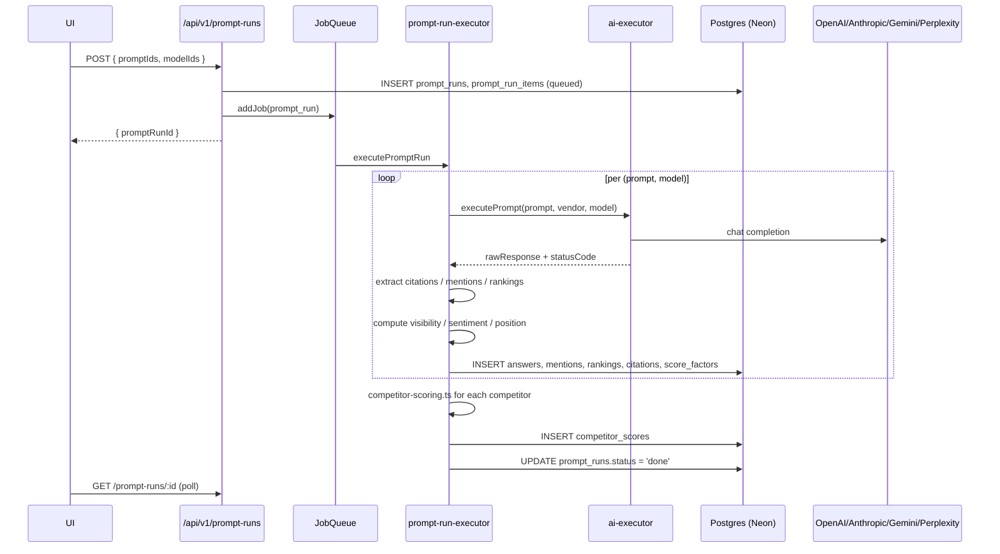

# 05 — Technical Architecture

## High-level shape

Polaris is a **single-process full-stack TypeScript app** running under one Node process on Replit. Express serves both the API and (via Vite middleware in dev / `serveStatic` in prod) the React SPA. All async work runs through an in-process job queue against a Neon-hosted Postgres database. LLMs are called through a thin provider abstraction.

```mermaid
flowchart LR
  subgraph Browser
    UI[React + Vite SPA<br/>Wouter / shadcn / TanStack Query]
  end

  subgraph Node[Single Node process — server/index.ts]
    EX[Express app]
    VITE[Vite middleware<br/>(dev) / serveStatic (prod)]
    ROUTES["/api/v1/* — server/routes/* (15 modules)<br/>+ /api/v1/auth/* — server/auth.ts<br/>+ /openapi.json, /api/docs — routes/openapi.ts"]
    STO[IStorage<br/>server/storage.ts +<br/>server/db-storage.ts]
    JQ[JobQueue<br/>server/services/job-queue.ts]
    PRX[prompt-run-executor.ts]
    SCORE[scoring.ts<br/>composer.ts<br/>visibility-scoring*.ts]
    XRAY[xray-* services]
    REP[report-job-processor.ts<br/>narrative-generator.ts<br/>pdf-*]
    LLM[server/llm/<br/>OpenAI / Anthropic clients]
    CRAWL[website-crawler.ts<br/>Crawlee + Playwright stealth]
  end

  subgraph External
    NEON[(Neon PostgreSQL<br/>via WebSocket pool)]
    OAI[OpenAI API]
    ANT[Anthropic API]
    GG[Google Gemini]
    PPL[Perplexity]
    WEB[(Public Web)]
  end

  UI -- HTTP /api/v1 --> EX
  UI -. HTML / JS .- VITE
  EX --> ROUTES
  ROUTES --> STO
  ROUTES --> JQ
  JQ --> PRX
  PRX --> SCORE
  PRX --> LLM
  JQ --> XRAY
  JQ --> REP
  XRAY --> CRAWL
  CRAWL --> WEB
  REP --> LLM
  STO --> NEON
  LLM --> OAI
  LLM --> ANT
  LLM --> GG
  LLM --> PPL
```

## Process model

- One Node process. `server/index.ts` boots Express, mounts JSON parsing (with raw-body capture), wires logging middleware (last-80-char truncated `/api` log line), calls `setupAuth(app)` (`server/index.ts:58` — wires session middleware, passport-local, and the `/api/v1/auth/*` routes), `await registerRoutes(app)` (which now delegates to the per-domain modules in `server/routes/index.ts`), seeds the DB (`server/seed.ts`), then starts listening on `PORT` (default `5000`) on `0.0.0.0`.
- Dev mode mounts `setupVite(app, server)` from `server/vite.ts`. Prod mode calls `serveStatic(app)`.
- `MAX_CONCURRENT_JOBS = 4` for background work (`server/services/job-queue.ts`).
- Heartbeat-based stale-job detection: jobs without heartbeat for `STALE_THRESHOLD_MS = 15 min` are recovered or failed; up to `MAX_RESUME_ATTEMPTS = 3` resumes.
- **Graceful shutdown** on SIGTERM/SIGINT (`server/index.ts:96–164`): close HTTP listener → `jobQueue.stopAcceptingJobs()` → `jobQueue.drain(SHUTDOWN_GRACE_MS)` (default 25s) → close Neon pool → `process.exit`. A separate `SHUTDOWN_FORCE_MS` (default 35s) hard-exits if drain hangs. Jobs that did not drain are recovered as stale on next boot.

## Request lifecycle (typical)

1. Browser issues `fetch /api/v1/...` via either the legacy `apiRequest` from `client/src/lib/queryClient.ts` or the typed `apiClient` (`openapi-fetch` over `shared/api-types.ts`); both attach the `x-client-id` header from `localStorage` and follow `redirect-to-/login` on 401.
2. Express middleware in `server/index.ts` captures method/path/status and JSON body for log line; session middleware + passport from `setupAuth(app)` populate `req.user`. The `/api/v1` middleware in `server/routes/index.ts` lifts the `x-client-id` header onto `(req as any).clientId` for `_helpers.getClientId` to consume. **Task #7 RBAC**: the same middleware stack mounts `requireAuth` + `requireTenantAccessIfPresent` globally on `/api/v1` (with a public-path skip-list for `/auth/*` and `/auth/invitations/:token/accept`); per-route `requireRole({minRole, scope})` is applied inline by every mutating handler, driven by the canonical matrix in `server/privileges.ts`.
3. The matching per-domain router in `server/routes/<domain>.ts` resolves tenancy via `_helpers.ts`, calls `IStorage` (`server/db-storage.ts`) for CRUD or invokes `JobQueue.addJob` for async work.
4. For job creation: route returns a `jobId`/`promptRunId`; the SPA polls (TanStack Query with exponential backoff) until status flips to `done`/`completed_with_errors`/`error`.
5. The job, when picked by `JobQueue`, fans out per (prompt × model) via `prompt-run-executor.ts` and `batch-executor.ts`, calls `ai-executor.ts` to hit each provider, persists raw responses + extractions + scores, and updates `prompt_runs.status` through the 4-stage model: `running → scoring → queued_for_benchmarking → benchmarking → done`.

## Concurrency & reliability

- **Per-job worker ID** prevents duplicate executors after a server restart (`jobWorkerIds` map and `jobs.workerId` column).
- **Heartbeats** are written every `HEARTBEAT_INTERVAL_MS = 30 s` to `jobs.lastHeartbeat`.
- **Checkpoints** live in `run_checkpoints` so a stale prompt run can be resumed mid-fanout (`completedItemIds`, `currentStage`).
- Frontend polling uses **exponential backoff** (TanStack Query) — see `client/src/lib/queryClient.ts`.

## Multi-tenant model

- `clients.orgId` is the tenancy key. `users` ↔ `user_org_memberships` ↔ `organizations` controls who can read/write a client.
- `organizations.id = "default-org"` is seeded; the frontend doesn't currently expose an org switcher. The seeded admin (`admin@polaris.local` / `[REMOVED: configure password in Replit Secrets]`, overridable via `DEFAULT_ADMIN_*`) is automatically a member of `default-org`.
- All routes resolve tenancy through `server/routes/_helpers.ts`: `getClientId` reads `x-client-id` header > `?clientId=` > legacy `?client_id=`; `getOrgId` reads `?orgId=` > legacy `?org_id=` (defaulting to `"default-org"` in handlers that fall back).
- Authorization: `server/auth.ts: requireClientAccess` (and the per-org analogues) reject 403 when the authenticated user has no `user_org_memberships` row for the target org.
- A `current-client-id` is persisted in `localStorage` and forwarded as `x-client-id` to bias responses for the chosen client.

## Data flow for one prompt run



## Error modes (observable)

- `statusEnum` includes `error`, `completed_with_errors` (some items failed but most succeeded), and `cancelled`.
- `prompt_run_logs` retains structured per-run logs.
- `performance-logger.ts` records latency and HTTP status per provider call.
- 429s (rate limit) are surfaced via `AIExecutionResult.isRateLimited`; `batch-executor.ts` orchestrates retries.
- LLM JSON parse failures are repaired once (`generateJsonWithRepair` in `server/llm/client.ts`).

## Build & deploy

- Dev: `npm run dev` (tsx + Vite middleware).
- Build: `npm run build` (Vite for client → `dist/public`; esbuild for server → `dist/index.js`).
- Start (prod): `npm run start`.
- Replit deploy: `vm` target, build = `npm run build`, run = `npm run start`, public dir = `dist/public`.
- Port `5000` is mapped to external `80` in `.replit`.
- Shutdown: VM deployments now respond cleanly to SIGTERM (rolling restarts, image swaps) — see "Process model" above.

## Notable architectural choices

- **Client-rendered SPA** under `/app/*` with public landing under `/`.
- **Wouter** instead of React Router for tiny bundle.
- **Drizzle ORM** with **Zod insert schemas** (`drizzle-zod`) — single source of truth in `shared/schema.ts`.
- **In-process job queue** (no Redis / BullMQ) — simpler operationally; less horizontally scalable.
- **Provider-agnostic LLM client** with **JSON-with-repair**.
- **Crawlee** for crawling with **Playwright fallback** + stealth — important for sites that block Cheerio.
- **Per-vendor LLM execution** in a `switch` (see `ai-executor.ts`) — easy to add Mistral/Cohere later.
