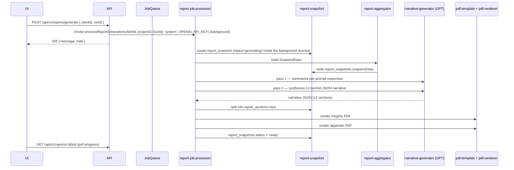

# 17 — Reporting and Exports

> **Authoritative API contract**: every endpoint signature (paths, params, response shapes) referenced below is normalized in **`09-api-reference.md`**, which is anchored line-by-line to `server/routes.ts`. If anything here disagrees with `09-`, `09-` wins.

## Overview

Reports are the consulting-grade artifact of Polaris. The pipeline produces **two PDFs** (Insights + Technical Diagnostic Appendix), plus optional **JSON** and **CSV ZIP** exports.

Configuration lives in `server/config/reporting.ts`:

- `AI_MODEL` — `REPORT_AI_MODEL` (default `gpt-5.1`).
- `AI_TEMPERATURE` — `REPORT_AI_TEMPERATURE` (default `0.7`).
- `MAX_RETENTION` — `REPORT_MAX_RETENTION` (default `5`) — number of snapshots retained per client.
- `ENABLED` — `ENABLE_REPORTING === 'true'`.

## Data model

| Table | Purpose |
|-------|---------|
| `report_jobs` | Background job lifecycle (queued → aggregating → analyzing → rendering → completed/failed) with `tokensUsed`, `costUsd`, `progressPercent`, `progressMessage`, `currentStep`, `modelUsed`. |
| `report_snapshots` | Stores `runIds` + the materialized `snapshotData` JSON used for narrative generation; status `generating | ready | failed`. |
| `report_sections` | One row per narrative section keyed by `report_section_name_enum`. |
| `report_files` | Output files: `pdf`, `insights_pdf`, `appendix_pdf`, `json`, `csv_zip`. |

## Pipeline

## The 12 narrative sections

From `report_section_name_enum` and `narrative-generator.ts` system prompt:

1. `executiveSummary`
2. `diagnosticOverview`
3. `competitiveLandscape`
4. `visibilityPerformance`
5. `criticalGaps`
6. `patternAnalysis`
7. `consultingInference`
8. `strategicImplications`
9. `leadershipConversations`
10. `businessImpact`
11. `actionPlan306090`
12. `implementationRoadmap`

Each section is markdown; `report_sections.sectionContent` is a markdown string. The narrative prompt contains explicit anti-duplication and consulting-tone directives.

## PDFs

- **Insights PDF**: targeted at executives/marketing leaders; sections 1–8 + 11–12.
- **Technical Diagnostic Appendix PDF**: targeted at technical/SEO teams; appendices with raw tables, prompt-by-prompt drilldowns, citations.
- **Renderer**: `server/services/pdf-renderer.ts`. Loads HTML built by `pdf-template.ts`, renders via Playwright (using the same Chromium binary resolution as crawler/X-Ray).
- **Storage**: `report_files.fileUrl` references the saved file path/URL; `fileSize` recorded.

## Other exports

| Endpoint | Generator | Output |
|----------|-----------|--------|
| `POST /api/v1/reports/generate` | `report-job-processor.ts: processReportGeneration` (background) | Body `{ clientId, runId }` (singular). Returns `202 { message, note }`; poll `GET /api/v1/reports?client_id=` for the new snapshot. |
| `GET /api/v1/reports/:id/download/pdf` | `pdf-renderer.ts` | Insights PDF binary stream. |
| `GET /api/v1/reports/:id/download/appendix` | `pdf-renderer.ts` | Appendix PDF binary stream. |
| `GET /api/v1/reports/:id/export` | `csv-exporter.ts`, `json-exporter.ts`, `zip-exporter.ts` | JSON / CSV ZIP per query param. |

## Snapshot data shape

`SnapshotData` (built in `report-snapshot.ts` / `report-aggregator.ts`) contains:
- `client` profile + competitor list.
- `runs` array with per-run metadata.
- Aggregated visibility/sentiment/position scores by run, by model, by category.
- Top-citation domains and authority signals.
- Top topics by mention.
- Recommendations summary (deduped + ranked).
- Per-prompt benchmark tables.
- The full `ConsultingDataPacket` structure consumed by the GPT narrative prompt.

The exact key list is large (~50+ keys); see `report-aggregator.ts` lines covering the `ConsultingDataPacket` builder for the canonical TypeScript types.

## Retention

- `REPORT_MAX_RETENTION = 5` snapshots per client by default.
- Cleanup: `report-job-processor.ts` (or the snapshot service) prunes the oldest snapshot beyond retention. (Verify in code if exact semantics matter.)

## Cost & latency tracking

- `report_jobs.tokensUsed` and `report_jobs.costUsd` capture per-job LLM cost and tokens (computed in `narrative-generator.ts` from response usage + model-price assumptions).
- `report_jobs.modelUsed` snapshots the model actually used (e.g., `gpt-5.1`).
- `report_jobs.progressPercent` is updated through stages (`aggregating` → `analyzing` → `rendering`).

## Failure modes

- LLM JSON repair is built in via `generateJsonWithRepair` in services that use `getClient()`. The narrative generator uses raw OpenAI SDK, so it has its own try/catch + status updates.
- Renderer failures (Playwright launch issues) propagate as `report_jobs.status = 'failed'` with `errorMessage`.
- Stale jobs are recovered through the `JobQueue`'s heartbeat mechanism the same way prompt runs are.

## Known limitations

- No streaming preview of narrative as it generates.
- No multi-language report output.
- No template overrides per client beyond what is hardcoded in `pdf-template.ts`.
- No external storage backend (e.g., S3) — files served from local paths in the deployment VM.
